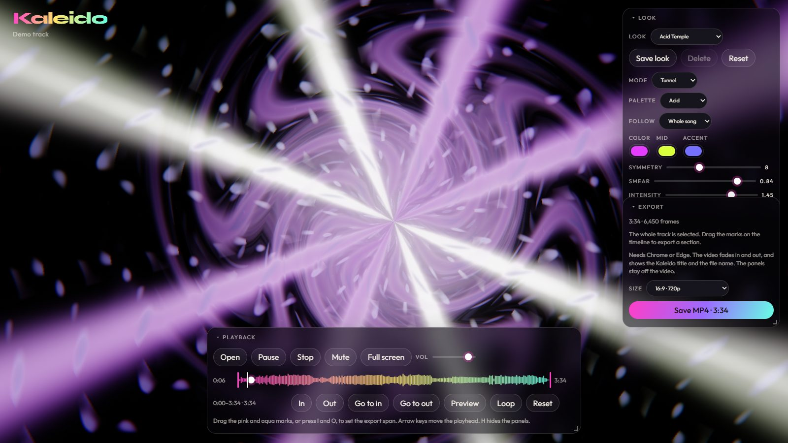

# Kaleido

A music visualizer that runs in the browser. Open a song, and Kaleido draws a picture that reacts to the kick, snare and hi-hats. Mark a section of the track and save it as an MP4.

**Try it: [kaleido.jacobroberts.dev](https://kaleido.jacobroberts.dev)**



Everything happens on your machine. The song is decoded, analyzed and encoded in the browser, and nothing is uploaded.

## Features

- Six scenes: Mandala, Tunnel, Liquid, Starfield, Halo and Weave.
- Six built-in looks (Acid Temple, Deep Void, Aurora Drift, Magma Burst, Halo Choir and Silk Weave), plus your own saved looks and palettes.
- MP4 export of any marked section at 16:9 720p, 16:9 1080p, 9:16 (1080×1920) or 1:1 (1080×1080).
- Opens MP3, WAV, FLAC, OGG and M4A. Drag a file onto the window or use **Open**.
- Works on phones. On small screens the panels become a dock along the bottom.

## How it works

**Listening.** The analysis doesn't use the browser's built-in analyser, so playback and export read the song the same way. Each frame takes a 2048-sample FFT, groups it into 72 log-spaced bands, and looks for hits in three ranges: kick below 220 Hz, snare up to 2.8 kHz and hats up to 14 kHz. An automatic gain follows the song's level so quiet and loud tracks both fill the picture.

**Drawing.** Each scene is a WebGL2 fragment shader. Frames render into 16-bit float buffers where the GPU supports them. Five of the scenes feed each frame back into the next, which makes the trails, and a Kawase blur adds the glow. Without WebGL2, every scene falls back to a 2D canvas mandala.

**Exporting.** The export doesn't record the screen. It renders each frame at 30 fps on its own clock, so a slow machine takes longer but never drops frames. It runs the scene for 2.5 seconds before the marked section so the first frame matches playback. Then it encodes H.264 video and AAC audio with WebCodecs and writes the MP4 with [Mediabunny](https://github.com/Vanilagy/mediabunny).

## Controls

Playback sits at the bottom center. Look and Export start stacked in the top right. Drag a title bar to move a panel, drag its corner to resize it, and click the title to collapse it.

- **Play** and **Pause** keep the playhead where it is. **Stop** pauses and returns to the start.
- The timeline shows the waveform. Drag the pink and aqua marks, or press `I` and `O`, to set the export span. **Preview** plays the marked span once, and **Loop** repeats it.
- **Look** sets the scene, symmetry, smear, intensity and palette together. Saved looks and palettes are stored in your browser.
- **Follow** makes the picture react to the whole mix, just the low end, or just the highs.
- **Export** writes an MP4 of the marked span with a small Kaleido title and the file name. The panels aren't in the video.

| Key | Action |
| --- | --- |
| `Space` | Play or pause |
| `I` / `O` | Set the export start or end at the playhead |
| `←` / `→` | Move the playhead 1 second (5 with `Shift`) |
| `H` | Hide or show the panels |

Double-click the picture for full screen.

## Browser support

Playback works in current browsers. MP4 export needs WebCodecs with H.264 encoding, which means Chrome or Edge.

## Run locally

```bash
npm install
npm run dev
```

Vite serves the app at http://127.0.0.1:5173/. To build for production:

```bash
npm run build
npm run preview
```

## License

MIT. See [LICENSE](LICENSE).
